# Teste Caixa Cinza com Supabase e Postman

> **Disciplina:** UX/UI e Testes de Software (AS406TSN1) — UniFacens
> **Aluno:** `João Vítor Vieira Skierzynski` — RA: 250964
> **Data dos testes:** 07/11/2026

---

# Introdução

Este repositório documenta a atividade prática de **testes funcionais de caixa cinza** em uma API de autenticação. Foi criado um ambiente de autenticação por e-mail e senha na plataforma **Supabase** e, em seguida, os endpoints de login foram testados com o **Postman Desktop**.

Nos testes de caixa cinza o testador conhece parcialmente a estrutura do sistema (endpoint, headers, formato do body JSON e códigos de resposta HTTP), mas não acessa o código-fonte interno. Nenhuma interface gráfica foi implementada nesta atividade.

**Estrutura do repositório**

```
/README.md
/postman/    -> coleção e environment exportados do Postman
/prints/     -> evidências (prints) geradas durante a atividade
/planilha/   -> planilha de registro dos testes
```

---

# Objetivo da Atividade

Compreender e aplicar testes de caixa cinza em APIs de autenticação, usando ferramentas de mercado para:

- configurar um ambiente de autenticação com Supabase;
- criar usuários de teste;
- compreender o funcionamento de requisições HTTP;
- executar testes no Postman;
- validar respostas de autenticação (status HTTP, JSON, mensagens de erro e access token);
- documentar tecnicamente todo o processo.

---

# Configuração do Supabase

### Como o projeto foi criado
1. Criei uma conta em https://supabase.com vinculando a minha conta do GitHub.
2. Em **New project** informei: organização **Zynskidogremio's Org**, nome do projeto **Zynskidogremio's Project**, senha do banco de dados e região **us-east-1** (AWS, leste dos EUA).
3. Mantive as opções padrão de *Security Options* e *Advanced Configuration* (Data API + Connection String, schema `public`, Postgres).
4. Aguardei o provisionamento e acessei o painel (Project Overview).

### Tipo de autenticação utilizada
Autenticação por **e-mail e senha** (provider *Email* em *Authentication > Sign In / Providers*, status **Enabled**).
A opção *Confirm email* ficou **habilitada**. Por isso, o usuário de teste foi criado com *Auto Confirm User* marcado, para conseguir fazer login sem confirmar o e-mail (um usuário não confirmado receberia o erro "Email not confirmed").

### Como o usuário foi criado
Em *Authentication > Users > Add user* criei o usuário de teste `joao.vitor.vieira@exemplo.com` (e-mail fictício), com uma senha definida por mim e a opção *Auto Confirm User* marcada.

### Credenciais obtidas
- **API URL (Project URL):** `https://cjeokqiboafdxveouzpg.supabase.co`
- **API KEY:** chave pública do projeto (*publishable/anon public*) (**não publicada neste README por segurança**; aparece tarjada nos prints).

### Objetivo da configuração
Disponibilizar um serviço real de autenticação (backend) contra o qual os endpoints de login possam ser chamados e validados, sem precisar construir um servidor próprio.

### Evidências
| Evidência | Print |
|---|---|
| Projeto criado | 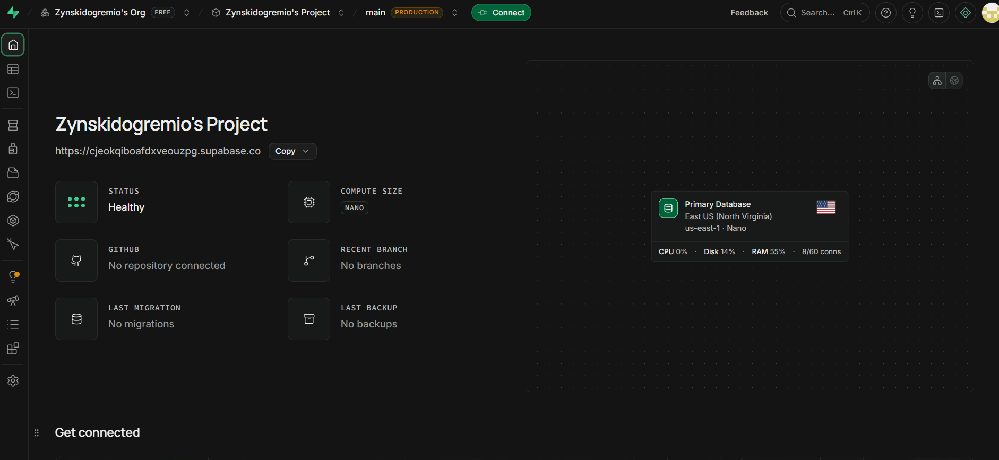 |
| Painel do Supabase (identificação do aluno) |  |
| Autenticação por e-mail habilitada | 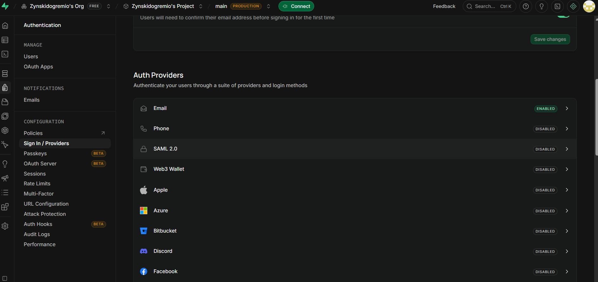 |
| Usuário criado | 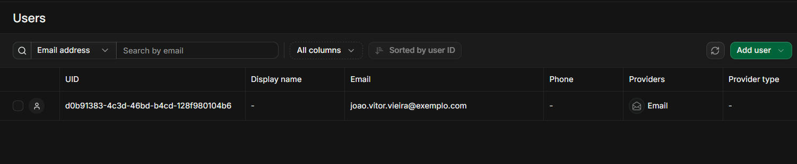 |
| Credenciais da API (key tarjada) |  |

---

# Configuração do Postman

### Workspace
Instalei o Postman Desktop, fiz login e criei o workspace **Atividade Supabase Caixa Cinza** (visibilidade: somente eu) pelo menu *Workspaces > Create Workspace*.

### Environment
Em *Environments* criei o ambiente **Supabase Auth - Environment** com as variáveis abaixo (arquivo exportado em `/postman/Supabase_Auth.postman_environment.json`, com valores de exemplo, sem credenciais reais).

| Variável | Descrição |
|---|---|
| `base_url` | URL da API do Supabase (Project URL) |
| `api_key` | API KEY (anon public) |
| `email` | E-mail do usuário criado |
| `password` | Senha do usuário criado |
| `access_token` | Preenchida automaticamente pelo script de teste do login válido |

### Finalidade das variáveis
Evitam repetir dados em cada requisição, permitem trocar de projeto/usuário alterando um único lugar e mantêm credenciais fora das requisições salvas e do repositório.

### Como o Postman é usado nos testes
Criei a collection **Supabase Auth - Testes Caixa Cinza** com 5 requisições (uma por cenário). Cada requisição possui scripts na aba *Tests* que validam automaticamente status e corpo da resposta. A execução pode ser individual (*Send*) ou em lote (*Collection Runner*). Arquivo: `/postman/Supabase_Auth_Caixa_Cinza.postman_collection.json`.

### Evidências
| Evidência | Print |
|---|---|
| Workspace criado | 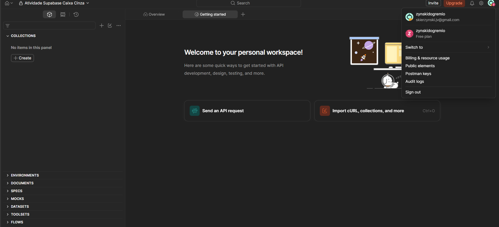 |
| Environment criado |  |
| Variáveis configuradas | 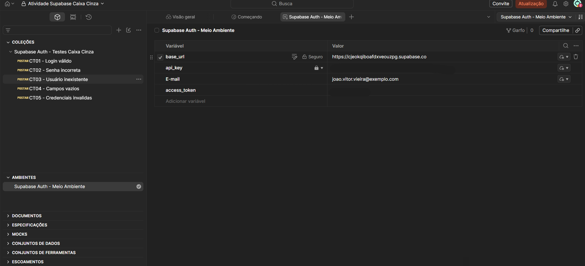 |
| Organização do Postman | 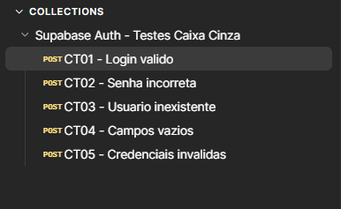 |

---

# Configuração das Requisições

| Item | Valor |
|---|---|
| **Endpoint** | `{{base_url}}/auth/v1/token?grant_type=password` |
| **Método HTTP** | `POST` |
| **Finalidade** | Autenticar um usuário por e-mail e senha e obter um `access_token` (JWT) |

### Exemplo de Header
| Header | Valor |
|---|---|
| `apikey` | `XXXXX` (valor de `{{api_key}}`) |
| `Authorization` | `Bearer XXXXX` (valor de `{{api_key}}`) |
| `Content-Type` | `application/json` |

### Exemplo do Body JSON
```json
{
  "email": "usuario@email.com",
  "password": "123456"
}
```
Na requisição real o body usa as variáveis: `"email": "{{email}}"` e `"password": "{{password}}"`.

### Evidências
| Evidência | Print |
|---|---|
| Endpoint configurado |  |
| Headers | 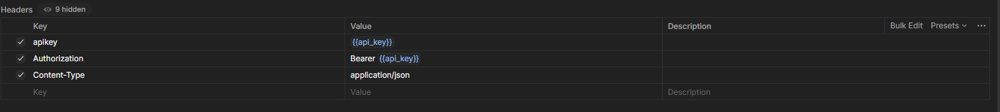 |
| Body JSON | 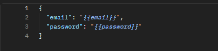 |

---

# Execução dos Testes

Foram executados os 5 cenários obrigatórios, todos contra o endpoint `POST /auth/v1/token?grant_type=password`.

| ID | Cenário | Entrada Utilizada | Resultado Esperado | Resultado Obtido | Status |
|---|---|---|---|---|---|
| CT01 | Login válido | `{{email}}` + `{{password}}` corretos | Status 200 + `access_token` | **200 OK**; JSON com `access_token`, `token_type: bearer`, `expires_in: 3600`, `refresh_token` e dados do usuário (`email_confirmed_at` preenchido) | OK |
| CT02 | Senha incorreta | e-mail correto + `SenhaErrada@999` | Erro de autenticação (400, `invalid_credentials`) | **400**; `error_code: invalid_credentials`, `msg: Invalid login credentials`; sem token | OK |
| CT03 | Usuário inexistente | `usuario.inexistente.teste@exemplo.com` + `Qualquer@123` | Acesso negado (400, sem token) | **400**; `error_code: invalid_credentials`, `msg: Invalid login credentials`; sem token | OK |
| CT04 | Campos vazios | `email: ""` e `password: ""` | Erro de validação (400/422) | **400**; `error_code: validation_failed`, `msg: missing email or phone`; sem token | OK |
| CT05 | Credenciais inválidas | `email-sem-formato` + `123` | Mensagem de erro | **400**; `error_code: invalid_credentials`, `msg: Invalid login credentials`; sem token | OK |

### Validações realizadas em cada teste
status HTTP, corpo JSON da resposta, mensagem de erro, presença/ausência do `access_token` e comportamento geral da autenticação.

### Erros / observações encontrados
- **Mensagem genérica:** senha incorreta (CT02), usuário inexistente (CT03) e e-mail malformado (CT05) retornaram exatamente a mesma resposta (`invalid_credentials`). O Supabase não diferencia os casos de propósito, para não revelar quais e-mails estão cadastrados.
- **Validação de campos vazios (CT04):** é o único cenário com `error_code` diferente (`validation_failed`, "missing email or phone"), pois a requisição é barrada antes de consultar as credenciais.
- **E-mail sem formato (CT05):** a API não retornou erro de formato de e-mail; tratou como credencial inválida. Vale considerar essa validação no front-end.
- **Falha de configuração (não da API):** na primeira execução no *Collection Runner*, o CT01 retornou 400 mesmo funcionando quando enviado sozinho. A variável `password` do Environment não estava sendo resolvida corretamente no Runner (valor vazio/incorreto). Após preencher os valores nas colunas *Initial value* e *Current value* e salvar o Environment, o CT01 passou com 200.

### Evidências
| Evidência | Print |
|---|---|
| CT01 — login válido, 200 e access token (token tarjado) |  |
| CT02 — senha incorreta | 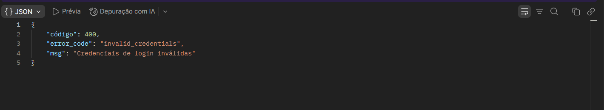 |
| CT03 — usuário inexistente | 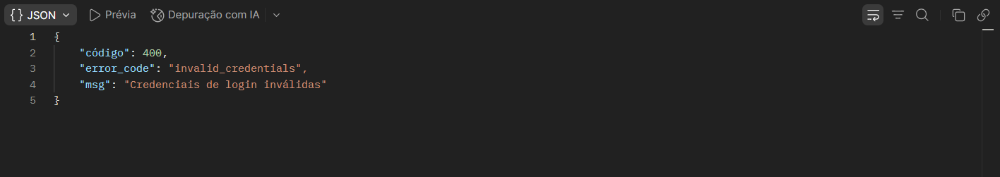 |
| CT04 — campos vazios | 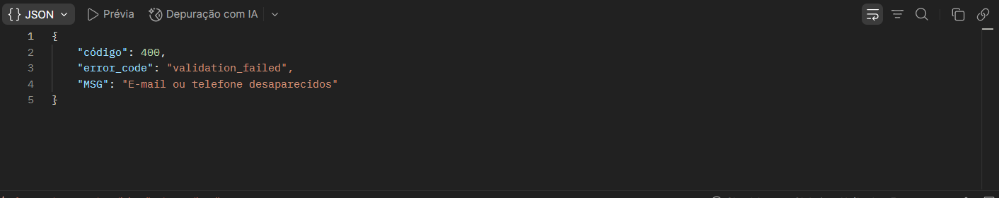 |
| CT05 — credenciais inválidas | 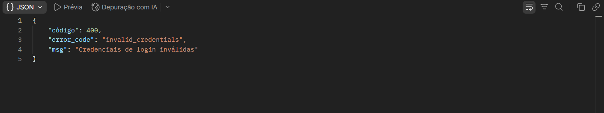 |
| Collection Runner — 1ª execução (CT01 com falha de configuração) | 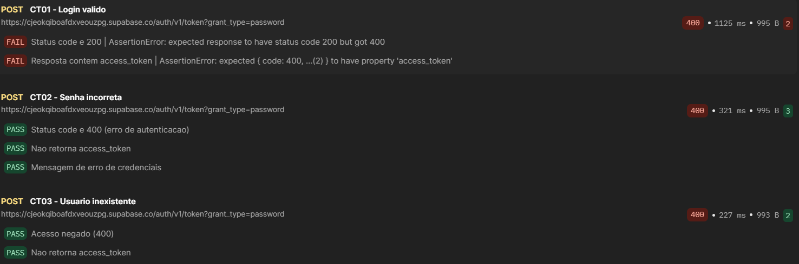 |
| Collection Runner — após a correção (11 testes passando) | 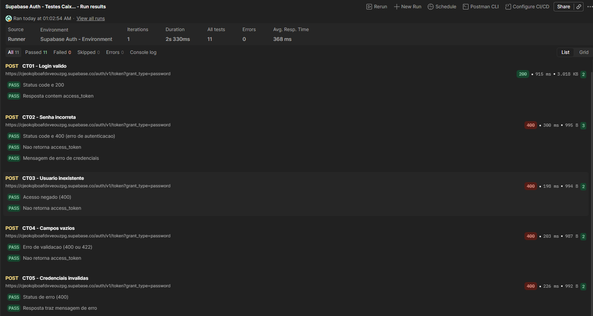 |

> **Observação:** a interface do Postman estava com tradução automática para o português. Por isso as respostas aparecem como `"código"` e `"Credenciais de login inválidas"`; na API o conteúdo original é `"code"` e `"Invalid login credentials"` (e `"missing email or phone"` no CT04).

---

# Registro dos Testes

### Como os testes foram registrados
Cada execução foi registrada na planilha `/planilha/Registro_Testes_Caixa_Cinza.xlsx` com os campos: ID do teste, cenário, entrada, resultado esperado, resultado obtido, status (Sucesso/Falha) e observações. A planilha segue o modelo PLANO_DE_TESTE visto em aula, com as abas INFORMATIVO (ambiente, responsável e data), SISTEMA (testes por componente/endpoint, com as colunas de entrada e resultado obtido) e ACEITAÇÃO (requisitos do usuário).

### Importância da documentação
Registrar os testes dá rastreabilidade (o que foi testado, com quais dados e quando), permite repetir os testes depois de qualquer alteração (regressão), facilita encontrar a causa de falhas e serve como evidência de qualidade.

### Falhas identificadas
A API de autenticação não apresentou falhas: os 5 cenários se comportaram como esperado. A única falha registrada foi de configuração do Postman (variável `password` não resolvida no Runner na primeira execução do CT01), descrita em *Execução dos Testes* e corrigida.

### Evidência


---

# Resultados Obtidos

| Total de testes | Sucesso | Falha |
|---|---|---|
| 5 | 5 | 0 |

O login válido (CT01) retornou 200 com `access_token`; os 4 cenários inválidos (CT02 a CT05) retornaram erro 400 e nenhum token, conforme esperado. Todos os testes automatizados da collection passaram no *Collection Runner* após a correção da variável `password`.

---

# Conclusão

- **Os testes foram executados corretamente?** Sim. Os 5 cenários obrigatórios foram executados individualmente e em lote no Collection Runner, e os resultados foram registrados na planilha.
- **A autenticação funcionou?** Sim. O usuário válido autenticou (200 + token JWT com validade de 3600 s) e todas as credenciais inválidas foram rejeitadas com erro 400 e sem token.
- **Dificuldades encontradas:** localizar a Project URL e a chave da API no painel do Supabase; configurar o Environment do Postman (a variável `password` chegou vazia/incorreta no Runner até eu preencher *Initial* e *Current value* e salvar); e entender que o Runner usa os valores salvos, não os digitados na tela.
- **Falhas identificadas:** nenhuma falha na API; somente a falha de configuração do Environment citada acima.
- **Melhorias possíveis:** testar também limites de tamanho de senha, e-mail com formato inválido e caracteres especiais; validar expiração e refresh do token; testar proteção contra força bruta (rate limit); automatizar a collection via Newman/CI; confirmar e-mail obrigatório em ambiente de produção.
- **Importância dos testes caixa cinza em APIs:** combinam o conhecimento da estrutura (endpoint, headers, body) com a verificação do comportamento externo, permitindo detectar falhas de autenticação, validação e mensagens de erro antes que cheguem à interface ou ao usuário, sem depender do código-fonte.
